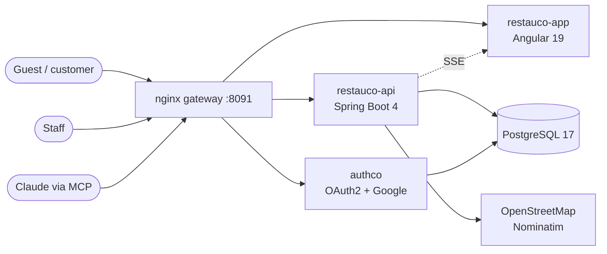

<div align="center">

# 🫓 Restauco

**Multi-tenant restaurant platform: menu, table QR orders, kitchen board, delivery and stats — in one app.**


</div>

Sibling of barberco (same stack and conventions). Demo tenant: **Toche's Arepas** (Venezuelan
street food, San Fernando, Cali); its menu is seeded from the menu board on its Google Maps profile.

## ✨ Features

| Area | Route | What it does |
|---|---|---|
| 🌐 **Public site** | `/`, `/menu` | Menu with photos, prices, descriptions, allergens and a "sin..." ingredient filter (dishes whose ingredient can be left out stay visible with "pídela sin ..."). |
| 📱 **Table QR** | `/mesa/{token}` | Guests order without an account; the order waits for a waiter to confirm it, then they follow it live through the kitchen. |
| 🛵 **Delivery** | `/domicilio` | Address search or GPS + draggable pin, server-side zone and address verification, live tracking. |
| 🧑‍🍳 **Waiter** | `/panel/mesas` | Floor map, QR orders to approve, pickups, fast order taking, bill closing with the restaurant's own payment methods. |
| 🔥 **Kitchen** | `/panel/cocina` | Live board (new / preparing / ready) with chime, delay colors, wake lock and sold-out toggles. "¡Listo!" alerts the waiter instantly. |
| 📊 **Statistics** | `/panel/estadisticas` | Sales vs the previous period (cut at the same hour), average ticket, by hour/day, best sellers, payment methods, waiters and kitchen times. Mobile first. |
| 🛠️ **Owner** | `/panel/carta`, `ingredientes`, `qr`, `pagos`, `equipo` | Menu editor with photos and option groups, ingredients and tags, printable table QR codes, payment methods, team. |
| 🤖 **MCP server** | `/restauco-api/mcp/<slug>` | Ask Claude about the restaurant, scoped by role. |

Login is authco (Google). Roles (OWNER, WAITER, COOK) live in restauco's `tenant_member`,
invited by email and linked on first login, and are enforced per panel area.

## 🏗️ Architecture



## Run

Postgres and authco are shared with the other apps on this machine and run in
[`../platform`](../platform/README.md); start that first:

```sh
(cd ../platform && docker compose up -d)
cp .env.example .env   # fill it in (USER_DB/PASSWORD_DB: the platform's restauco role)
docker compose up -d --build   # -> http://localhost:8091
```

The gateway proxies `/authco` to the shared authco, so login stays on restauco's own origin.
`BOOTSTRAP_OWNER_EMAIL` becomes the first OWNER.

### Public demo (Cloudflare quick tunnel)

```sh
docker compose --profile demo up -d tunnel
docker compose logs --since 1m tunnel | grep -o 'https://[a-z0-9-]*\.trycloudflare\.com'
# put that URL in PUBLIC_URL (.env) and in RESTAUCO_URL (../platform/.env), then:
(cd ../platform && docker compose up -d authco)
docker compose up -d restauco-api restauco-app
```

Add `<PUBLIC_URL>/authco/login/oauth2/code/google` to the Google OAuth client. The
`restauco-app` client lives in the shared authco database, so add the new callback to it too
(otherwise `/oauth2/authorize` answers 400):

```sh
(cd ../platform && docker compose exec postgres psql -U restauco -d authco -c "update oauth2_registered_client \
  set redirect_uris='http://localhost:8091/auth/callback,<PUBLIC_URL>/auth/callback', \
      post_logout_redirect_uris='http://localhost:8091/,<PUBLIC_URL>/' where client_id='restauco-app'")
```

The URL changes every time the tunnel container is recreated, and so must both `.env` files,
Google and that client.

Tests: `docker run --rm -v "$PWD":/w -w /w amazoncorretto:25-alpine ./gradlew test`
(or `env JAVA_HOME=$(mise where java@25) ./gradlew test`).

## Layout

- `src/` Spring Boot 4 API (`/restauco-api`), clean architecture like barberco:
  `entity/` domain, `usecase/`, `infrastructure/` (controllers, JPA, SSE hub).
  Tenant = `X-Tenant` header, Hibernate `@TenantId`.
- `restauco-app/` Angular 19 SPA, runtime `config.json`, tenant theme in `src/themes/`.
- `deploy/` gateway (nginx, SSE-aware) and postgres init (standalone k8s); `k8s/` kustomize
  (standalone, or `k8s-shared` on the platform's Postgres and authco).
  Secrets are not committed: `cp k8s/config/secret.example.yml k8s/config/secret.yml` and fill it in.

## Real time

`/api/panel/stream` (staff) and `/api/public/tables/{token}/stream` (guests) are Server-Sent
Events sent after each transaction commits. The SPA reads them with `fetch` (EventSource cannot
send `Authorization`/`X-Tenant`), reconnects with backoff and refetches on every reconnect.
Quick tunnels do not pass SSE through, so when `ready` does not arrive within 5 s the client
switches to polling the sibling `/events?after={cursor}` endpoints every 2.5 s: the same
events, kept for 5 minutes in `EventLog` (an expired or unknown cursor makes it refetch).
In-memory fan-out: one API replica. Several replicas need Postgres LISTEN/NOTIFY in `SseHub`.

## Sold-out ingredients

The kitchen ("Agotados" → Ingredientes) or the owner (Ingredientes) marks an ingredient as run
out. A dish that cannot go without it stops being orderable; one where it is removable is served
without it (the ticket says "sin X"); a modifier option made with it (`ingredientIds`, set in the
dish editor under each option) cannot be chosen, and a dish whose required choice has no option
left is sold out too. Staff screens reload the menu on the `menu` live event.

## Delivery

`/domicilio` on the public site. The customer builds the order, finds the address (text search
or GPS) and drags the pin to the door. The API checks everything again when ordering: the pin
must be a street address on the map (OpenStreetMap Nominatim, `restauco.geocoder.url`), inside
the zone, the phone Colombian, prices from the menu. The order lands on **Domicilios** in the
panel as "por confirmar", with the written address next to what the map found at the pin (and a
warning when the streets differ); the waiter confirms it to the kitchen, dispatches it with the
courier, and charges it when the courier is back. A delivery is a bill without a table
(`table_session.table_id` null + `delivery_fee`), so sales reports include it. The customer
follows it at `/domicilio/<token>`. The owner sets zone, fee and minimum order in **Reparto**.

The public Nominatim allows about one request per second: calls are spaced and cached, and the
public endpoints are rate-limited per IP. For more traffic, run your own Nominatim or switch the
`GeocodingGateway`.

## MCP server (ask Claude about the restaurant)

`<PUBLIC_URL>/restauco-api/mcp/<restaurant>`, e.g. `https://…/restauco-api/mcp/toches-arepas`.
Streamable HTTP, stateless JSON-RPC. Each member sees only the tools of their role:

| Tool | What | Roles |
|---|---|---|
| `get_sales_report` | sales of TODAY / WEEK / MONTH vs the period before, by hour/day, payment method, waiter, top dishes, kitchen times | OWNER |
| `get_floor` | every table: free or open, bill so far, rounds waiting / in kitchen / ready | OWNER, WAITER |
| `get_table` | the open bill of a table (by number) with its rounds | OWNER, WAITER |
| `list_active_orders` | rounds not delivered yet | all |
| `get_menu` | menu by category: ids, prices, sold out, removable ingredients, options | all |
| `set_dish_availability` | mark a dish sold out / on sale again | OWNER, COOK |
| `set_ingredient_availability` | mark an ingredient run out / back (dishes and options follow) | OWNER, COOK |
| `list_deliveries` | deliveries not charged yet (no phone or exact address) | OWNER, WAITER |

Auth: authco OAuth. A 401 points to the RFC 9728 metadata (served by Spring Security, exposed
at the origin root by the gateway), which names authco; MCP clients register themselves (DCR
allows the claude.ai/claude.com callbacks) and the user logs in with Google. Only members of that
restaurant get through.

In Claude: Settings → Connectors → Add custom connector → paste the URL → log in with the staff
Google account. Local check: `npx @modelcontextprotocol/inspector` against the URL above.

## New restaurant

1. Insert the tenant (Flyway migration or SQL) with its `branding` JSON
   (`tagline`, `hours`, `phones`, `mapsUrl`, `paymentNote`, optional `theme` color overrides).
2. Add `restauco-app/src/themes/<slug>.css` with the same tokens, import it in `styles.css`,
   and deploy the SPA with `TENANT=<slug>`.
3. Set `BOOTSTRAP_OWNER_EMAIL`/`BOOTSTRAP_TENANT`, or insert the owner in `tenant_member`.
